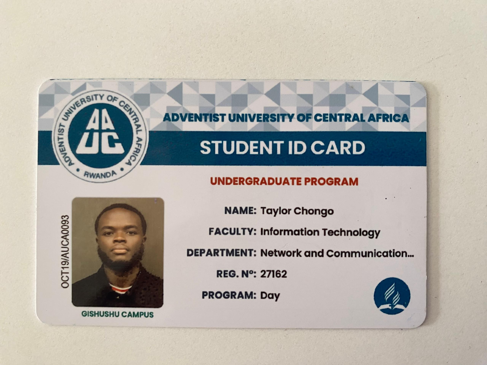
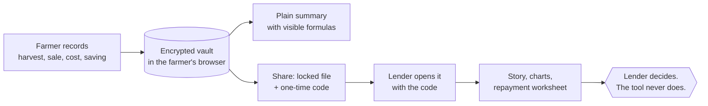
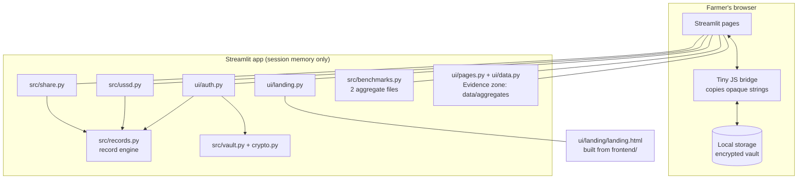

# FinBridge

**Farm records that farmers own and lenders can read.**

Most of Rwanda's farming households have a bank, SACCO or microfinance account, yet only a small share hold a
formal loan. FinBridge has two connected parts that share one evidence base:

- **Evidence** (for SACCOs, BNR, MINAGRI and AFR): an analysis of NISR's Agricultural Household Survey 2024 and
  FinScope Rwanda 2024 showing where farm households are *banked but not financed*, who is left out, and why.
- **Farmer tools** (the response to that evidence): a farmer keeps simple records on any phone, locks them with a PIN,
  and chooses to share them with a lender who reads them as a plain story with charts. The tool never scores anyone and
  never decides a loan.

Built for the **NISR 2026 Big Data Hackathon**, **Track 2: Financial Inclusion and Poverty Reduction**. It supports
**NST2** (agricultural transformation, financial inclusion) and **Vision 2050**.

| | |
|---|---|
| **Live app** | https://finbridge-rwanda.streamlit.app/ |
| **Demo video** | [`docs/FinBridgeDemo.webm`](docs/FinBridgeDemo.webm) (4:50, screen recording with narration) |
| **Judges: how to log in** | No account is needed, see [Trying the live app](#trying-the-live-app) |
| **Screenshots** | [`docs/screenshots/`](docs/screenshots): every page at 1280 px and 390 px |
| **Source code** | https://github.com/patrickntirenganya/FinBridge-Rwanda |
| **Team and eligibility** | [Student ID cards of both members](#team-and-eligibility) |
| **Security note** | [`docs/security.md`](docs/security.md) |
| **Demo script** | [`docs/demo_script.md`](docs/demo_script.md) |
| **Evidence and feature plan** | [`docs/02_evidence_and_features.md`](docs/02_evidence_and_features.md), [`docs/03_combined_build_plan.md`](docs/03_combined_build_plan.md) |
| **Data** | NISR microdata is not redistributed; the aggregate tables we built are in [`data/aggregates/`](data/aggregates) and the download links are in [section 6](#6-research-data-and-methods) |

> **One app, two zones.** The **Evidence** pages show the survey research (aggregate NISR statistics with confidence
> intervals); the **farmer** pages show no survey statistics except an optional peer reference for harvests and inputs.
> A test enforces that the zones never import each other. Nothing gives a **score, a default prediction or a lending
> decision**.

## Team and eligibility

Both team members are undergraduate students at the Adventist University of Central Africa (AUCA), Faculty of
Information Technology, Network and Communication. Student ID cards are in [`eligibility/`](eligibility).

| Member 1 (team leader): Ntirenganya Patrick | Member 2: Taylor Chongo |
|---|---|
|  |  |

## Trying the live app

No login is needed and nothing you do is saved on a server.

| To see | Do this |
|---|---|
| The evidence | Open **Home**, press **See the evidence**, then browse the Evidence pages (overview, who gets formal credit, the SACCO map, social protection, loan purposes, farmers vs other adults, districts, what the evidence suggests, data and methods) |
| The farmer tool | Open **My farm records** and press **Just looking? Try the demo**. It loads invented records and an example loan plan, so every tab (add, summary, share, harvest check, loan plan) can be tried. Nothing is stored |
| The lender view | Open **Open a farmer's report** and press **See an example farmer** |
| A real sign-up (optional) | **My farm records → Create profile**: enter any valid Rwandan mobile number (for example `0788123456`), press *Send a code*, and type the 6-digit code **shown on screen** (this build has no SMS gateway), then choose a non-trivial PIN. Data is encrypted in your own browser |
| A farmer-to-lender share | Sign in or use the demo, open the **Share** tab, create a share, download the `.fbshare` file, then open it on **Open a farmer's report** with the code shown. The code works once |

Apps that get no visits go to sleep on Streamlit Community Cloud; if you see a "wake up" button, press it.

## At a glance

**The question.** Half of Rwanda's farm households have a bank, SACCO or MFI account but no formal loan. *Why does
having an account not turn into credit, and what would let a lender see a farm they cannot see today?*

**Why we think it is a real problem.** In the AHS 2024, 62.7% of agricultural households have an account but only
14.1% have a formal loan, and the gap is widest for the poorest, female-headed and smallest households (full table in
[section 1](#1-the-problem)). The results are survey-weighted, carry confidence intervals, and reproduce NISR's
published tables ([validation](#validation)). The models show associations, not causes, so we make no claim that
records alone would change who gets a loan. That is what a pilot must test ([roadmap](#12-roadmap)).

**What the evidence says.** Besides the national gap, the analysis locates it. About **759,000** households
(35.1% of farm households) hold an account yet borrowed only informally, concentrated in districts such as
Nyagatare, Gisagara and Gicumbi. **81.1%** of farm households have a tontine member and **57.8%** of tontine borrowers
already hold a SACCO account, so a link between savings groups and SACCOs already exists. Adults in households that
received a VUP cash transfer are much less likely to have a bank account (**7.1% vs 21.3%**). Each is an association,
and the recommendations page labels every idea a hypothesis until it is piloted.

**What we built.** Evidence pages with the findings above, and a tool that turns a farmer's own records into something
a lender can read, with the farmer in control of who sees it:

1. **The farmer records** harvests, sales, costs, savings (and where they are held: MoMo, Ibimina, SACCO or bank),
   food kept at home, and income from outside crop sales. This works on a smartphone or, through the USSD simulator,
   a basic phone.
2. **The records stay on the farmer's phone**, locked with a PIN. Nothing is stored on a server.
3. **The farmer chooses to share.** They make a locked file and give the lender a single-use code.
4. **The lender reads a plain story with charts** and a repayment worksheet that is arithmetic on the lender's own
   terms. There is no score and no decision. The lender decides.
5. **The farmer can state a loan purpose** (the most cited reason for refusal is an "unclear purpose") and see how a
   harvest compares with similar plots, as guidance only.

**Who it is for.**

| User | Why |
|---|---|
| **Smallholder farmers**, above all women-led, poorer and small-plot households | The groups the data shows are most left out of formal credit |
| **Loan officers** at SACCOs, MFIs and banks | They need evidence about farmers they cannot otherwise assess |
| **BNR, MINAGRI, AFR** | The Evidence pages show where the gap sits and which ideas deserve a pilot |
| **Later:** cooperatives, buyers and policymakers | Buyers could confirm sales; policymakers can see where the gap sits |

**The impact we expect, and what we do not claim.** If a farmer builds a season of records, a lender gets something to
read instead of guessing, and the farmer keeps control of their data. These are hypotheses. **We have no evidence yet
that the tool changes loan approvals, so we claim none.** Entries are the farmer's own word unless a receipt or transaction reference is typed in
(and even that is unchecked), so nothing in the tool is called verified. See [limitations](#7-limitations-and-responsible-use).

## Contents

0. [Trying the live app](#trying-the-live-app) and [At a glance](#at-a-glance)
1. [The problem](#1-the-problem)
2. [From research to product](#2-from-research-to-product)
3. [What the product does](#3-what-the-product-does)
4. [Security and privacy](#4-security-and-privacy)
5. [Architecture](#5-architecture)
6. [Research data and methods](#6-research-data-and-methods)
7. [Limitations and responsible use](#7-limitations-and-responsible-use)
8. [Run it locally](#8-run-it-locally)
9. [Test it](#9-test-it)
10. [Deploy it](#10-deploy-it)
11. [How this meets the judging criteria](#11-how-this-meets-the-judging-criteria)
12. [Roadmap](#12-roadmap)
13. [Repository layout](#13-repository-layout)
14. [Credits, licences and references](#14-credits-licences-and-references)

---

## 1. The problem

Among Rwanda's **2.16 million agricultural households** (AHS 2024, survey-weighted):

| Finding | Estimate |
|---|---|
| Have a bank, SACCO or MFI account | **62.7%** |
| Have a formal loan | **14.1%** |
| Have an account but **no** formal loan ("banked but not financed") | **50.2%** (95% CI 48.1–52.4) |
| Have an account yet borrowed **only** informally, mostly through tontines | 35.1%, about 759,000 households |
| Formal loan, poorest vs richest consumption quintile | 10.8% vs 23.9% |
| Formal loan, female- vs male-headed households | 7.8% vs 16.3% |
| Formal loan, under 0.1 ha vs over 1 ha of land | 9.8% vs 25.3% |
| Loans for farm inputs that come from formal lenders | 10.8% |
| Loans taken to buy food | 29.4% |

**Where and who** (AHS 2024; the SACCO map page and the social protection page carry the intervals):

| Finding | Estimate |
|---|---|
| Largest district counts of account holders who borrowed only informally | Nyagatare ≈ 48,800, Gisagara ≈ 42,400 (53.3% of its households), Gicumbi ≈ 37,200, Nyamagabe ≈ 34,800 |
| Households with a tontine member | 81.1% (95% CI 79.2–83.1) |
| Tontine borrowers who already hold a SACCO account | 57.8% (95% CI 55.3–60.2, n = 1,850) |
| Informal-only borrowers with an account who borrowed for a farm purpose | 35.5% |
| Most cited reasons for a refused loan | unclear purpose 29.7%, collateral 23.6%, insufficient income 20.9% (n = 295, wide CIs) |

FinScope Rwanda 2024 (adults): in households that received a VUP direct cash transfer, **7.1%** have a bank account
against **21.3%** elsewhere (n = 1,078; FinScope intervals are understated). Formal credit looks similar (14.1% vs
13.4%) only because Government (Ubudehe/VUP) loans count as formal; without them it is 10.7% vs 13.1%.

FinScope Rwanda 2024 (adults): formal credit reaches **8.5%** of adults in farming-only households against **19.8%**
in non-farming households. About **13.5%** of farming adults own a smartphone, while **64.2%** own a phone of any kind
and **73.8%** are registered mobile-money users.

Every figure above is reproduced by `python analysis/key_findings.py` from the committed aggregate tables, and the
AHS estimates match NISR's published tables ([validation](#validation)).

**What it means.** Farmers are already inside the financial system but cannot turn that into credit. Lenders cannot
judge a farm they cannot see, so most borrowing stays informal and small. The missing piece is a record a lender can
read, one that works for people with basic phones and little digital experience.

**Policy context.** MINAGRI states that NST2 and PSTA5 aim to raise agriculture's share of the national loan portfolio
from 6% to 10% by 2029
([source](https://www.minagri.gov.rw/updates/news-details/minagri-and-rab-spiu-encourage-farmers-to-embrace-the-national-agriculture-insurance-scheme-nais)).
That target is about loan *value*, so we use it as context only and never derive it from our household percentages.

## 2. From research to product

Each design choice traces back to a finding. We mark which links are direct responses and which are hypotheses that
need a field pilot.

| What the research found | What we built | Status |
|---|---|---|
| Most farm households have an account, few have a formal loan, and lenders lack records they can read | Farm records the farmer owns, plus a lender view that turns them into a plain story and charts | Direct response |
| Only a minority of farming adults own a smartphone; most own any phone and use mobile money | USSD route for basic phones, big tap buttons, Kinyarwanda first, no email or password | Direct response |
| Most borrowing is informal (tontines, relatives), so lenders cannot see cash flow | Month-by-month money in and out, cumulative cash, and prompts to ask about other loans | Direct response |
| Loans for farm inputs rarely come from formal lenders | Input costs (seed, fertiliser, labour) recorded by category so an input-finance lender can see them | Hypothesis, needs a pilot |
| Female-headed and smallest households have lower formal-loan rates | A free, phone-first tool with no individual score, so it adds no new hurdle | Hypothesis, needs a pilot |
| About half of farming adults say they already track money | Make tracking a one-minute tap flow instead of a new habit | Design assumption |
| The most cited reason for a refused loan is an unclear purpose (29.7% of 295 refusals) | A loan purpose sheet: what the money is for, items, cost, timing, repayment, groups | Hypothesis, needs a pilot |
| Plots differ widely and most are intercropped, so one national yield benchmark would mislead | A harvest check against AHS plots of the same crop and season, as a band, never saved or exported | Guidance only |
| Savers and tontine members already exist at scale | Evidence pages that show where, and recommendations labelled as hypotheses (savers, tontines, input credit, women-headed households, VUP recipients) | Hypotheses, need a pilot |

The adjusted models below show the gaps are not just a side effect of wealth or land. They are **associations, not
causes**.

| Formal loan, odds ratio (AHS, survey-weighted logistic, n = 3,717) | OR | 95% CI |
|---|---|---|
| Female-headed vs male-headed household | 0.43 | 0.32–0.57 |
| Richest vs poorest quintile | 2.87 | 1.91–4.30 |
| Over 1 ha vs under 0.1 ha | 2.39 | 1.40–4.07 |
| Has titled land vs none | 1.47 | 1.04–2.08 |
| Cooperative member vs not | 1.28 | 0.93–1.76 (not clear) |

## 3. What the product does



### 3.0 The Evidence pages

| Page | What it shows |
|---|---|
| **Overview** | The four-way split (account and formal loan, account but informal only, account but no borrowing, no account) and where households borrow |
| **Who gets formal credit** | Formal-loan rates by consumption quintile, sex of head, farm size, land title, cooperative membership |
| **Where SACCOs could reach savers** (F1) | A map and table of district counts of account holders who borrowed only informally, with 95% ranges, districts under n = 30 greyed out and not ranked; plus *Tontines: an existing bridge* (F2) and the India SHG–Bank Linkage lesson |
| **Social protection and finance** (F3) | VUP and Ubudehe category 1 against others on bank account, mobile money, saving, emergency fund and insurance, and the government-loan effect on "formal credit" shown separately |
| **Loan purposes and barriers** | What loans are for, where input loans come from, why loans are refused, why adults do not borrow |
| **Farmers vs other adults** | FinScope comparison of farming and non-farming adults |
| **Districts** | Any indicator by district, with confidence intervals and suppression |
| **What the evidence suggests** | Five recommendations, each split into *what the data show* (evidence-backed or not) and *hypothesis*, with a model from elsewhere, its source and a link to the figures |
| **Data and methods** | Data sources, weights, suppression, validation against NISR's published tables |

Screenshots of every page are in [`docs/screenshots/`](docs/screenshots).

### 3.1 For farmers

**Five tabs:** add a record, my summary, share, harvest check, loan plan.

**Loan plan (tab 5).** The most cited reason for a refused loan in AHS is an "unclear purpose" (29.7% of 295 refusals,
wide CIs). The loan purpose sheet lets a farmer state what the money is for (inputs, equipment, livestock, other), the
items and quantities, the expected cost, planting and harvest months, how it would be repaid (crop sales, other income)
and which groups they belong to (tontine, cooperative, Twigire Muhinzi), and download it as a one-page printable
summary. It is saved with the profile (encrypted, in the JSON backup), goes to a lender **only if the farmer ticks
"include my loan plan"** when sharing, and says plainly that a clear plan does not guarantee a loan. That a plan helps
approval is a hypothesis, not a finding.

**Harvest check (tab 4).** A farmer enters crop, season, harvest and plot area (and the share of the plot the crop
covers, because most plots are mixed) and sees whether the harvest is below, typical for or above most similar AHS 2024
plots, as a band with the quartiles, never as a verdict. It is computed on screen from `yield_benchmarks.json`, carries
the source line, and is never saved in a record, backup, share file or report (a test proves this).

**Sign in with a phone number and a PIN.** No email, no password, no account on our server. Creating a profile starts
with a **one-time code** sent to the phone, so a farmer proves the number is theirs; in this build no SMS is sent and the
code is shown in a clearly labelled demo box until a gateway is connected.
- The PIN is 4 to 6 digits and must not be trivial (no `1111`, no `1234`, no end of the phone number).
- Records are encrypted with a key derived from the PIN and stored in the farmer's own browser. A locked backup file
  (`.fbvault`) restores them on another phone.
- After four wrong tries the app makes the farmer wait (30 seconds, doubling up to 15 minutes). After 15 idle
  minutes it locks itself.
- **Try the demo** lets anyone look around with invented records, with nothing saved.

**Record in three taps.**

| Step | What the farmer does |
|---|---|
| 1. What happened? | Tap *I harvested*, *I sold*, *I spent*, *I saved* or *Other income* |
| 2. Which crop or cost? | Tap a picture button (maize, beans, potato, cassava, sorghum, rice, banana, coffee, tea, vegetables, milk, other; or seed, fertiliser, pesticide, labour, transport, equipment, land rent, loan repayment, other) |
| 3. How much? | Type the amount in RWF (and the quantity for harvests and sales) |

Date, buyer or seller, unit and "Receipt or transaction reference (optional)" are tucked under *More details*. A
confirmation sentence follows, such as "Saved: you sold Maize for 50,000 RWF."

**Read a plain-language summary.** For the chosen season: *"Between these dates you sold X, spent Y, and have Z left."*
Under that sit four figures, a monthly money-in and money-out chart, and a *detailed figures* section with the formula,
average price per kg and share of harvest sold. Seasons follow Rwanda's calendar: **A** (Sep–Jan), **B** (Feb–Jun),
**C** (Jul–Aug).

**Share only what they choose.** The *Share* tab creates a locked `.fbshare` file and a random code such as
`P4G4-NSFG-VXEP`:

| Farmer's choice | Default |
|---|---|
| Which period (all dates or one season) | all |
| Include names of buyers and sellers | **off** |
| Include the farmer's own name | on |
| How long the share stays open | 7 days (1, 7 or 30) |

The farmer gives the lender the file and tells them the code separately, in person or by phone. A plain HTML report
and a CSV are also available for printing.

**Use a basic phone.** The *USSD preview* is a working simulation of the same tool on a feature phone. Every screen
is 160 characters or fewer and uses the same record engine as the web page.

```
FinBridge
1 Record sale
2 Record expense
3 Record harvest
4 Record saving
5 My summary
0 Exit
```

### 3.2 For lenders (SACCOs, MFIs, banks, cooperatives)

No account is needed. The lender opens the locked file with the farmer's code and optionally types their institution
name, which appears only on their own access receipt.

| Tab | What the lender sees |
|---|---|
| **At a glance** | A *"What the records say"* story of plain facts (period covered, totals, main income source, biggest cost, months with sales, savings, share backed by receipts), four key figures, monthly money in and out, cumulative cash, where income came from, where money went, price per kg and share of harvest sold |
| **Repayment worksheet** | The lender types a loan amount, term and interest. The sheet shows the monthly repayment, the farmer's recorded net for each month against that line, and how many months covered it. It is arithmetic on figures the lender sets. It gives **no verdict**, and a *"read this with care"* box lists the caveats |
| **Record quality** | Months with entries, how entries are backed (the farmer's own word or a typed reference, not checked), simple counts, and questions the lender may ask |
| **All entries** | Every record with its evidence type, plus a notes box that lives only in the session and can be downloaded |

The *At a glance* tab also shows where savings are held, the food the household keeps (kilograms valued at the farmer's own
sale price, never a guessed market price, and not counted as income), and crop sales against other income by month.
Savings appear beside the repayment worksheet as a line of their own and are never merged into a ratio. The page prints
without menus or buttons.

The monthly repayment uses the standard level-payment formula, `P·r / (1 − (1 + r)^−n)` with `r` the monthly rate, or
`P / n` when the rate is zero.

**What the lender is told, and the farmer's records can never claim.** Every entry is *self-reported* unless the
farmer types a receipt or transaction reference, which is then labelled *Reference attached, not checked*. The app never
parses or "verifies" messages. A third level, *confirmed by a buyer
or cooperative*, is reserved for a future verifier, and an imported file can never grant it.

### 3.3 Throughout

- **Languages.** Kinyarwanda (default) and English, switchable in the sidebar. The Kinyarwanda is a working draft that
  needs native-speaker review before field use.
- **Landing page.** A TypeScript and Tailwind page with photos of Rwandan farmers, explaining the problem, both
  user paths and the trust promises, with no statistics.
- **About page.** What the tool is and is not, privacy, evidence types, limits and a link to this research.
- **Accessible by design.** Large tap targets, plain verbs, sentence case, a font designed for legibility (Atkinson
  Hyperlegible), reduced-motion support and works down to phone width.

### 3.4 What the product deliberately does not do

- It shows no survey statistics to farmers except the labelled peer reference (AHS 2024, same crop and season, guidance only), which is never saved or exported.
- It gives no individual score, no default prediction and no lend or do-not-lend verdict.
- It does not verify entries or the phone number.
- It claims no effect on loan approval until it has been piloted.

## 4. Security and privacy

The design keeps farmers' data on their own device by default, asks for consent before anything is shared, and says
plainly what it cannot protect. The full threat model is in [`docs/security.md`](docs/security.md).

| Area | How it works |
|---|---|
| **Encryption** | AES-256-GCM with a fresh random nonce per save; key derived from PIN and phone number with scrypt (N = 2^16, r = 8, p = 1, 64 MB, about 0.4 s per guess) and a random salt per vault |
| **Storage** | The encrypted vault lives in browser local storage and in a downloadable backup. **Nothing is stored on a server.** Unlocked data and the key sit in session memory only while signed in and are cleared on lock, on leaving, and after 15 idle minutes |
| **Guess protection** | PIN rules, lock-out that grows to 15 minutes, identical error for wrong phone, wrong PIN or damaged file |
| **Phone check** | Sign-up needs a 6-digit one-time code (5 minutes, 3 tries, 30 seconds between sends, only a salted hash kept). Demo build: shown on screen, no SMS sent |
| **Sharing** | Locked file plus a random 12-character code (about 59 bits, no confusable letters) that **works once**, a chosen period and validity, buyer names off by default, rate-limited code attempts, an access receipt for the lender |
| **Untrusted input** | Every imported file is strictly parsed (known fields and types only); text from a farmer's file is HTML-escaped on the lender page |
| **Purpose binding** | A vault cannot be opened as a share and the reverse, because the purpose is bound into the ciphertext |

**Honest limits.**
- Someone who *copies* the vault can guess a short PIN offline. With slow key derivation a 4-digit PIN falls in about
  an hour of computing on one core and a 6-digit PIN in about four days. The app steers farmers to six digits and a
  private backup.
- The phone check is demo-only: the code is shown on screen, so it proves nothing until an SMS gateway is connected.
- "Works once" is remembered in server memory, so an app restart forgets it. A database would make it permanent.
- A lender who has opened a share can keep what they saw, like a printed report. The farmer is told this first.
- Farmer accounts (phone + PIN, encrypted vault) are stored in Firestore. Lender identity and a server-side audit log are not built.
- The prototype has **not been independently audited**.

## 5. Architecture



**Design principles.**
1. **One record engine, many channels.** `src/records.py` is channel-agnostic. The web tool, the USSD simulator, the
   report, the lender view and a future SMS channel all use it.
2. **Security code has no UI.** `src/crypto.py`, `vault.py` and `share.py` are plain, separately tested modules.
3. **Strings in one place.** All text is in `src/i18n.py` as Kinyarwanda and English pairs, with a test that checks
   every key is filled in both languages with matching placeholders.
4. **Research and product are separate.** `pipeline/` and `analysis/` produce the research tables; only the Evidence
   pages read them. Farmer-zone code may read just the two benchmark files through `src/benchmarks.py`, and a test
   fails if either zone imports the other.

| Layer | Technology |
|---|---|
| App framework | Streamlit 1.65+ (pages, forms, `st.iframe`, Components v2 for the storage bridge) |
| Charts and maps | Plotly (CI bars, choropleth maps) |
| Landing page | TypeScript, Tailwind CSS 3, Vite, built to one self-contained HTML file |
| Cryptography | `cryptography` (AES-256-GCM, scrypt) |
| Data and tables | pandas, numpy |
| Research pipeline | pyreadstat, statsmodels, scipy (only needed to rebuild the research tables) |
| Tests | Streamlit `AppTest`, plus direct tests of the engine, crypto, vault, share and USSD |

## 6. Research data and methods

### Data

Both datasets are NISR public-use microdata and are **not** redistributed here. Register on the NISR Microdata Portal
and download:

| Dataset | Catalogue | Place the file at |
|---|---|---|
| FinScope Rwanda 2024 (RWA-NISR-FINSCOPE-2024-v01) | https://microdata.statistics.gov.rw/index.php/catalog/120 | `data/raw/FinScope_2024_Rwanda.dta` |
| Agricultural Household Survey 2024 (RWA-NISR-RAHS-2024-V0.1) | https://microdata.statistics.gov.rw/index.php/catalog/123 | `data/raw/Microdata.zip` |

`data/raw/` is git-ignored. Only aggregate tables are committed:

| File | Contents |
|---|---|
| `ahs_national.csv`, `ahs_segments.csv` | National indicators and the four-way account/loan segmentation |
| `ahs_by_group.csv` | Indicators by quintile, head's sex, farm size, province, district, cooperative and more |
| `ahs_loan_sources.csv`, `ahs_loan_purpose.csv`, `ahs_denial_reasons.csv` | Where loans come from, what they are for, why they are refused |
| `fs_national.csv`, `fs_by_group.csv`, `fs_barriers.csv`, `fs_farmer_digital.csv`, `fs_records_link.csv` | FinScope adult indicators (including the VUP and Ubudehe-1 groups for F3), barriers, phone and mobile-money use, record-keeping |
| `ahs_district_opportunity.csv` | F1: per district, the share and number of households with an account that borrowed only informally, with 95% ranges, n and reliability (3 Kigali districts suppressed, n < 30) |
| `ahs_tontine_bridge.csv` | F2: tontine membership, SACCO accounts among tontine borrowers, farm-purpose borrowing among informal-only savers |
| `yield_benchmarks.json`, `input_use.json` | Farmer harvest check and peer input use (the only two files the farmer pages may read) |
| `models.csv` | Odds ratios with confidence intervals |
| `validation.csv`, `meta.json` | Checks against NISR's published tables; sample sizes and build date |

District boundaries for the maps are in `data/geo/` (geoBoundaries ADM2, CC BY 4.0).
`docs/01_dataset_audit.md` and `docs/variable_inventory.csv` document the datasets and variables we examined.

### Methods

- **Weights and design.** AHS: weight `weight`, primary sampling unit `clust`, stratum `district`, with Taylor-linearised
  confidence intervals (`src/survey.py`). FinScope: weight `pop_wt`; the public file has no PSU, so **FinScope
  intervals are understated**.
- **Suppression.** Cells with n < 30 are suppressed; a coefficient of variation above 0.30 is flagged "caution".
- **Indicators.** Defined once in `src/indicators.py`; `pipeline/build_aggregates.py` turns microdata into the committed
  tables.
- **Models.** Weighted logistic regression of formal loan on welfare quintile, head's sex, farm size, land title,
  cooperative membership and province, with design-based sandwich standard errors (`src/models.py`). Associations only.
- **Yield bands (farmer tool).** From AHS Section 3, every plot x crop slot 1-7: yield = harvest kg / (plot area x crop
  share of plot). Per crop and season the top and bottom 1% of yields are trimmed, then weighted quartiles are taken:
  sort yields, accumulate `weight`, and take the first yield whose cumulative weight share reaches 0.25, 0.50, 0.75
  (no interpolation). Groups under 100 plots are omitted. Bands are guidance for the farmer on screen only and are
  never stored or exported. Input-use shares are plot-level weighted proportions; the improved-seed denominator is
  seasonal-crop plots where seed type was recorded.
- **District counts (F1).** Per district: the design-based share of households with a formal account that borrowed only
  informally, multiplied by that district's weighted household count; the CI bounds scale the same way. Districts with
  fewer than 30 sampled households are not reported, so the 27 reported districts sum to about 749,000 against the
  national ≈ 759,000. Districts are sorted by count, never ranked, because the intervals overlap.
- **Tontine bridge (F2).** A household is a tontine member if any member answers yes to `s10cq8`; the SACCO share is
  computed on households that took a tontine loan; the farm-purpose share (inputs, equipment or livestock) on
  households with an account that borrowed only informally.
- **Social protection (F3).** FinScope `c13d` (household received a VUP direct cash transfer; "don't know" excluded) and
  Ubudehe category 1 against the rest. `formal_credit` counts a Government (Ubudehe/VUP) loan as formal, so the page also
  shows credit without it and that loan on its own.
- **Recommendations.** Each card separates a *finding* (evidence-backed when the confidence intervals of the compared
  groups do not overlap) from an *idea* (always a hypothesis until piloted). Raw gaps are labelled unadjusted.
- **No record linkage** between AHS and FinScope. They are compared side by side as aggregates.

### Validation

AHS estimates reproduce NISR's published tables ([`validation.csv`](data/aggregates/validation.csv)):

| Indicator | Ours | Published | Source |
|---|---|---|---|
| Household has a bank, SACCO or MFI account | 62.7 | 62.7 | AHS Main Report, Table 32 |
| Household requested a loan | 71.1 | 71.1 | Table 34 |
| Loans from tontines (share of loans) | 58.1 | 58.1 | Table 35 |
| Loans from relatives or friends | 25.1 | 25.1 | Table 35 |
| Loans from SACCOs | 6.0 | 6.0 | Table 35 |
| Cooperative membership | 11.8 | 11.8 | Table 30 |

FinScope mobile money (76.2 vs 77) and bank account (20.2 vs 22) reconcile. Our formal saving, credit and insurance
figures are lower than the official strands because the official strand code is not public, so we use FinScope for
**group comparisons, not national totals**.

### Reproduce the research

```bash
pip install -r requirements-pipeline.txt
python pipeline/build_aggregates.py     # needs data/raw/ (see Data)
python analysis/key_findings.py         # prints the headline findings with CIs and n
```

## 7. Limitations and responsible use

**Research limits**
- The surveys are cross-sectional: nothing here shows that records or credit *cause* better outcomes.
- AHS `s10aq1` is labelled "tried to obtain a loan", but every "yes" has a denial reason, so we treat it as "reported
  a denial" (n = 295, wide intervals).
- The AHS milk, egg and honey files contain many exact duplicate rows and are not used.
- The "always track money" question went to about half of respondents; estimates use answerers only.
- FinScope intervals are understated (no cluster variable in the public file), so the VUP comparison is more certain
  than it looks.
- Three Kigali districts (Gasabo, Kicukiro, Nyarugenge) have too few sampled agricultural households to report, and
  district counts rest on about 120 sampled households per district, so single-district differences are not meaningful.
- The adjusted regression (F4), the what-if calculator (F5) and the shocks page (F6) are not built.
- Every recommendation beyond "this gap exists" is a hypothesis. We have no pilot and no evidence on loan approval.
- Yield bands compare self-reported harvests with self-reported survey plots; most plots are intercropped, so a band
  is guidance and never a verdict.

**Product limits**
- Entries are self-reported and unverified. The prototype cannot tell a true record from a false one.
- A short PIN protects a *copied* vault only weakly (see [Security](#4-security-and-privacy)).
- Phone numbers are not verified, and there are no lender accounts or server audit log yet.
- The USSD menu is a simulation, not connected to a telecom gateway.
- The Kinyarwanda text needs native-speaker review.
- We claim **no impact on loan approval** without a pilot.

**Responsible use.** The tool describes a farm's own records. It does not score individuals, predict default or make
lending decisions, and it never will in this design, so a lender stays responsible for the decision. The design
follows common data-protection principles (consent, minimisation, security) that Rwanda's personal data protection law
also expects, but it has not had legal review. A real deployment needs a registered data controller, a Kinyarwanda
privacy notice and a data-protection impact assessment.

## 8. Run it locally

**Requirements:** Python 3.11 or newer. Node.js 18 or newer is needed only if you change the landing page.

```bash
git clone https://github.com/patrickntirenganya/FinBridge-Rwanda.git
cd FinBridge-Rwanda
python -m venv .venv && source .venv/bin/activate     # Windows: .venv\Scripts\activate
pip install -r requirements.txt
streamlit run app.py                                  # opens http://localhost:8501
```

The product needs no survey data and no secrets.

**Change the landing page** (TypeScript + Tailwind, source in `frontend/`):

```bash
cd frontend
npm install
npm run build          # type-checks, builds, and writes ui/landing/landing.html
```

`ui/landing/landing.html` is committed, so Streamlit Cloud needs no Node.

## 9. Test it

```bash
python tests/test_app.py        # must print "199 renders, 0 failures" (about two minutes)
```

The suite needs only `requirements.txt`. It covers:

| Area | What is checked |
|---|---|
| **Every page** | Renders in Kinyarwanda and English, including every option of every selector |
| **Farmer flows** | Demo entry, the tap-to-record flow, saving a record, every season in the summary and report |
| **Record engine** | Totals, insights, the farm story, loan instalment arithmetic, report escaping and disclaimers, import validation (junk rows skipped, `confirmed` evidence refused) |
| **Vault** | PIN and phone rules; wrong PIN, wrong phone and tampering rejected; no plaintext in storage; fresh nonce each save; junk files rejected; lock-out schedule |
| **Sharing** | Wrong code, tampering, expiry, season filter, names dropped unless chosen, no plaintext in the file |
| **Sign-in** | End to end: sign up, autosave a record, lock, sign in again, five wrong PINs, lock-out holds against the right PIN |
| **Lender page** | Opens a real share; hostile text in a farmer's file is escaped |
| **USSD** | Every screen is 160 characters or fewer, both languages, menus re-prompt on bad input |
| **Language** | Every string exists in both languages with matching placeholders |
| **Zones** | The Evidence zone never imports farmer, share, vault or crypto code, and the farmer zone never imports the Evidence loader; only `src/benchmarks.py` reads aggregate files, and only two |
| **Benchmarks** | Harvest bands reproduce the reference medians; a band never appears in a record, backup, share file or report |
| **Evidence figures** | 30 districts match the boundary file and total about 759k; tontine figures; VUP and Ubudehe figures; the recommendation cards (structure, sources, no causal wording) |
| **Loan plan and evidence levels** | Plan validation, escaping, backup round trip, shared only when ticked; a typed reference is "attached, not checked" and an import can never grant "confirmed" |
| **Landing** | The landing copy contains no percentage |

The browser-storage bridge cannot run inside `AppTest`, so it was verified separately in a real browser: create a
profile, confirm the stored vault holds no plaintext, reload, see the remembered phone, refuse a wrong PIN, accept the
right one.

## 10. Deploy it

The app deploys to **Streamlit Community Cloud** from this public repository.

1. Make sure the repository is **public**.
2. Sign in at https://share.streamlit.io with GitHub and choose **Create app → Deploy a public app from GitHub**.
3. Set repository `patrickntirenganya/FinBridge-Rwanda`, branch `main`, main file `app.py`.
4. Under **Advanced settings**, pick Python 3.11 or newer. No secrets are needed.
5. Deploy. Cloud installs `requirements.txt` (app dependencies only).
6. After it is live: create a profile, reload and sign in again (this checks browser storage on the live domain),
   then try the lender page and the demo. Check a real phone.

**Live app.** https://finbridge-rwanda.streamlit.app/ The deployed app needs no login: see [Trying the live app](#trying-the-live-app).

Notes: apps that get no visits go to sleep and need a click to wake, so open the app shortly before judging. One
sign-up briefly uses about 64 MB for key derivation.

**Troubleshooting**

| Symptom | Likely cause |
|---|---|
| Landing page missing | `ui/landing/landing.html` not built; run `cd frontend && npm run build` |
| "Loading…" never ends on *My farm records* | Browser blocks local storage; use *Continue without saving on this device* and rely on the backup file |
| Sign-in says "Wrong phone number or PIN" | Wrong credentials, a damaged file, or a different browser (the vault lives in the browser it was created in; restore from the backup file) |
| Lender cannot open a share | Wrong code, damaged file, or the share expired; ask the farmer for a new one |

## 11. How this meets the judging criteria

| Criterion | How FinBridge answers it |
|---|---|
| **Problem relevance (NST2 / Vision 2050)** | A direct response to the gap between financial access and formal credit among farm households, supporting agricultural transformation and financial inclusion |
| **Data use and methodology** | Two NISR surveys analysed with survey weights and design-based errors, with a district map of the 759k gap, a tontine bridge and a social-protection lens; adjusted models; estimates validated against NISR's published tables; every recommendation split into finding and hypothesis; findings traced to each design choice ([section 2](#2-from-research-to-product)) |
| **Tangible impact** | A working tool that farmers and lenders can use today, built for basic phones; honest about what a pilot must still prove |
| **Technical innovation** | Evidence and tools in one app with a tested boundary between them; local-first encryption with consent-based sharing and encrypted farmer accounts in Firestore (the server cannot read them); one record engine across web and USSD; a lender story generated from the farmer's own records; TypeScript and Tailwind front end |
| **Usability** | Three-tap recording, plain-language summaries, large targets, Kinyarwanda first, phone-number-and-PIN sign-in, a one-click demo |

## 12. Roadmap

Not part of the hackathon build:

0. **Analysis still to add:** adjusted regression of formal loans (F4), a transparent what-if calculator for converting
   existing savers (F5), and a shocks-without-a-cushion page (F6), as set out in
   [`docs/02_evidence_and_features.md`](docs/02_evidence_and_features.md). Household-level shock alerts, satellite
   farm lending and pest or weather SMS need data feeds we do not have.

1. **Pilot** with a SACCO and a cooperative, to test whether lenders find the records useful and measure any effect on
   access.
2. **Verified lenders:** institution accounts and a server-side audit log (needs a small database).
3. **Third-party confirmation:** buyers and cooperatives confirm entries, enabling the `confirmed` evidence level.
4. **Phone verification** by SMS, and a **PIN change** option.
5. **A real USSD gateway** with a telecom partner.
6. **Native-speaker review** of every Kinyarwanda string; voice prompts and a pictures-only mode for low-literacy
   users.
7. **Independent security review** and legal review under Rwandan data-protection law.

## 13. Repository layout

```
app.py                     entry point: navigation, language, auth flush
requirements.txt           app dependencies (what Streamlit Cloud installs)
requirements-pipeline.txt  extra packages to rebuild the research tables

src/
  records.py               record engine: validation, summaries, insights, farm story, loan instalment, report
  loanplan.py              loan purpose sheet: validation, sanitising, one-page printable summary
  benchmarks.py            harvest band and peer input use (reads two aggregate files only)
  vault.py                 PIN-locked profile: create, unlock, reseal, PIN rules, lock-out
  share.py                 encrypted share package, one-time code, expiry
  crypto.py                scrypt and AES-256-GCM primitives
  ussd.py                  USSD menu state machine (screens <= 160 characters)
  i18n.py                  every string, Kinyarwanda and English
  indicators.py, survey.py, models.py, load.py   research code (not used by the app)

ui/
  landing.py               embeds the landing bundle
  pages.py, data.py        Evidence pages (overview, who, SACCO map, social protection, loan purposes, farmers vs
                           adults, districts, recommendations, methods) and their aggregate loader (evidence zone)
  farmer.py                sign-in gate, tap-to-record flow, summary, sharing, USSD preview
  lender.py                opening a share; story, charts, worksheet, quality, entries
  auth.py                  sign-up, sign-in, restore, erase, browser-storage bridge, idle lock
  about.py                 how it works, limits, link to the research
  theme.py                 colours, CSS, hero banner
  assets/, landing/        logo, farmer photos, built landing page

frontend/                  Vite + TypeScript + Tailwind source of the landing page

pipeline/                  microdata -> data/aggregates/*.csv
analysis/                  variable inventory, key findings
data/aggregates/           committed research tables (safe to publish)
data/geo/                  district boundaries (display only; not used by the app)
data/raw/                  NISR microdata, git-ignored, never committed

tests/test_app.py          the test suite
docs/                      security note, demo script, evidence and build plans, dataset audit, variable inventory
docs/screenshots/          every page at 1280 px and 390 px
```

**Contributor rules.**
- Never commit microdata (`.dta`, `.zip`, `data/raw/`, `*.pkl`).
- Change an indicator only in `src/indicators.py`, then rebuild the aggregates and rerun the tests.
- Add every user-facing string to `src/i18n.py` in both languages.
- Never add a score, a prediction or a lending decision.
- Run `python tests/test_app.py` after every change.

## 14. Credits, licences and references

- **Data:** National Institute of Statistics of Rwanda (NISR), Agricultural Household Survey 2024 and FinScope Rwanda
  2024 (with Access to Finance Rwanda). Public-use microdata; follow the NISR terms of use and do not redistribute.
- **Photographs:** photos of Rwandan farmers were supplied by the team for this prototype. Confirm their licence and
  the subjects' consent before any public release beyond the hackathon.
- **Boundaries:** geoBoundaries ADM2 for Rwanda, CC BY 4.0. See [`data/geo/README.md`](data/geo/README.md).
- **Font:** Atkinson Hyperlegible, loaded from Google Fonts.

**References**
- National Institute of Statistics of Rwanda (2024). *Agricultural Household Survey 2024*, main report and microdata.
- National Institute of Statistics of Rwanda and Access to Finance Rwanda (2024). *FinScope Rwanda 2024*.
- Republic of Rwanda. *National Strategy for Transformation (NST2)* and *Vision 2050*.
- MINAGRI and RAB SPIU: agriculture's share of the loan portfolio, NST2 and PSTA5 target, and NAIS.
  https://www.minagri.gov.rw/updates/news-details/minagri-and-rab-spiu-encourage-farmers-to-embrace-the-national-agriculture-insurance-scheme-nais
- People's Bank of China: guidelines on rural credit households. https://camlmac.pbc.gov.cn/en/3688110/3688172/4048362/2025080817551068801/index.html
- NABARD and microfinance (2002), India's SHG–Bank Linkage. https://findevgateway.org/sites/default/files/publications/files/mfg-en-paper-nabard-and-microfinance-2002.pdf
- One Acre Fund (2025). *Q4 performance report*. https://www.globalgiving.org/pfil/59148/2025_Q4_One_Acre_Fund_Performance_Report.pdf
- Banerjee, A. et al. (2015). A multifaceted program causes lasting progress for the very poor: evidence from six
  countries. *Science* 348(6236). https://economics.mit.edu/sites/default/files/2022-08/science.1260799.pdf
- Runfola, D. et al. (2020). geoBoundaries: a global database of political administrative boundaries. *PLOS ONE*
  15(4): e0231866.
